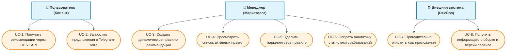

# 📋 Требования к системе и варианты использования

## 👥 Акторы системы
1. **Пользователь (Клиент банка):** Физическое лицо, запрашивающее персональные рекомендации через REST API или Telegram-бот.
2. **Менеджер (Маркетолог/Аналитик):** Сотрудник банка, управляющий динамическими правилами и собирающий статистику их срабатываний.
3. **Внешняя система (DevOps/Мониторинг):** Автоматизированная система сопровождения, выполняющая сброс кэшей и сбор метаданных о сборке.

---

## 🗺️ Диаграмма вариантов использования (Use Case Diagram)

---

## 📝 Функциональные требования (User Stories)

* **US-FR-1:** Как **Пользователь**, я хочу отправлять запрос на `GET /recommendation/{user_id}`, чтобы мгновенно получать список доступных мне банковских продуктов.
* **US-FR-2:** Как **Пользователь**, я хочу использовать команду `/recommend Имя Фамилия` в Telegram-боте, чтобы получать персональные предложения прямо в мессенджере.
* **US-FR-3:** Как **Менеджер**, я хочу отправлять `POST /rule` с JSON-набором предикатов (`USER_OF`, `ACTIVE_USER_OF`, `TRANSACTION_SUM_COMPARE`, `TRANSACTION_SUM_COMPARE_DEPOSIT_WITHDRAW`), чтобы добавлять новые маркетинговые правила без изменения кода.
* **US-FR-4:** Как **Менеджер**, я хочу выполнять `GET /rule`, чтобы просматривать полный список всех активных динамических правил.
* **US-FR-5:** Как **Менеджер**, я хочу выполнять `DELETE /rule/{product_id}`, чтобы удалять неактуальные правила вместе с их статистикой.
* **US-FR-6:** Как **Менеджер**, я хочу выполнять `GET /rule/stats`, чтобы видеть количество срабатываний каждого правила и оценивать эффективность кампаний.
* **US-FR-7:** Как **Внешняя система**, я хочу отправлять `POST /management/clear-caches`, чтобы принудительно очищать кэш рекомендаций при обновлении данных.
* **US-FR-8:** Как **Внешняя система**, я хочу отправлять `GET /management/info`, чтобы получать актуальное название и версию приложения из файла сборки.

---

## 🛡️ Нефункциональные требования (Non-Functional Requirements)

* **NFR-1 [Производительность и кэширование]:** Повторные SQL-запросы к базе транзакций кэшируются в оперативной памяти с помощью библиотеки Caffeine (паттерн *get-if-absent-compute* с TTL 10 минут), снижая время отклика API.
* **NFR-2 [Надежность и логирование ошибок]:** Все некорректные запросы и исключения времени выполнения централизованно перехватываются через `@ControllerAdvice` (`GlobalExceptionHandler`) и фиксируются в журнале логов SLF4J без раскрытия внутренних трассировок стека клиенту.
* **NFR-3 [Безопасность и целостность данных]:** База транзакций `transaction.mv.db` изолирована в режиме `READ_ONLY`. Удаление динамического правила в PostgreSQL каскадно удаляет связанные записи статистики.